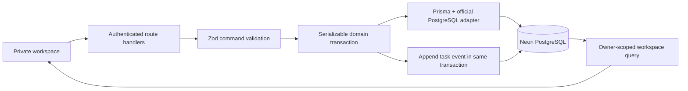

# Architecture and decisions

## The three records

**Intention** is the current `tasks` row. **Action** is evidence in `task_events` and dated `task_effort_entries`. **Observation** is an independent `journal_entries` row. Journal entries do not require or contain a task foreign key. Linking categories and entities supplies context without merging these concepts.

The unified timeline is a query/composition over these records, never a duplicate timeline table. Capture/planning events are presented as intention changes, other task events and effort as action, and journal entries as observations. Dated effort has no invented time of day.

## Request flow

The App Router page checks a database-backed session before retrieving any private data. Client controls call a same-origin POST command endpoint; the user ID comes from the session, never the request. A refresh retrieves authoritative data rather than assuming the write succeeded. A task version prevents a stale editor from overwriting a newer status/details change. Serializable conflicts return 409 and ask the user to refresh; no silent retry can duplicate effort or journal entries.

## Data integrity

- UUID identifiers; explicit indexes, uniqueness, ownership and deletion rules.
- Every owned table has `user_id`. The normal Prisma foreign keys provide navigation. Additional composite SQL foreign keys `(linked_id, user_id)` enforce that both ends belong to the same owner, including all junction tables. These SQL-only constraints are deliberate and must be retained in future migrations.
- Category/entity ancestry is checked in commands and in PostgreSQL recursive triggers. Owner-scoped advisory locks plus serializable mutation transactions avoid concurrent conflicting moves. Use the same transaction isolation if changing hierarchies through external scripts.
- Old tasks are retained. Archival is a timestamp; completion, cancellation and reopening update current state and append events atomically. No public hard-delete endpoint is implemented.
- Events are append-only at the database level. Planning removal sets `removed_at`; re-adding creates a new row. A partial unique index prevents duplicate active assignments.
- Template changes create a new revision, deactivate the previous version, and leave historical task definitions and values attached to the original version. Existing task templates cannot be switched. Used template fields cannot be added, changed or deleted.
- Custom values occupy at most one typed column; SQL checks storage/type/template membership and select options. Required-field presence is validated transactionally in the command layer. Dates and datetimes use separate columns; multi-select options use JSONB arrays.
- Foreign keys use `RESTRICT` throughout owner data. Historical records are not silently removed by cascading deletes. Authentication sessions can be deliberately deleted for revocation; login buckets are infrastructure, not personal history.

## Dates and effort

`planned_date`, planning boundaries, and `occurred_on` are PostgreSQL `date` values. Instants use `timestamptz`. The owner’s IANA timezone controls today, journal/reminder entry, timeline day grouping, and instant-based statistics. Date-only work remains a calendar date. A week starts on Monday.

Effort is optional, in whole minutes, with multiple dated entries. The legacy `manual_actual_minutes` task field is retained from the approved schema; detail totals use it only if no effort entries exist. Date-range analytics deliberately use dated entries only. This avoids silently mixing an undated total into a date range.

Analytics aggregate effort IDs directly. Categories roll up through descendants, with one primary category per task. Entities also roll up descendants, deduplicating a task if several links lead to the same ancestor. Tag/entity rows overlap and are explicitly labelled non-additive. Completion/deferral statistics count historical events, including multiple genuine completion events following reopening; they are not labelled unique tasks.

## Single-user security

There is no registration or public data mode. An environment allowlist and password hash identify the owner. Sessions are random opaque tokens; only hashes are stored. Every API/page verifies both the session and the configured owner email. HTTPS deployment produces secure cookies. Exact-origin checks protect writes, and private responses are not shared-cacheable. Security headers restrict framing, MIME sniffing, browser permissions and external script destinations. CSP retains inline scripts/styles for Next.js rendering; no user-authored HTML is interpreted.

The built-in throttle is a global owner window, durable across serverless instances. This limits guessing but allows temporary deliberate lockout; it is a conscious private-MVP tradeoff. The password hash can be rotated via environment settings, with explicit session revocation documented in the README.

## MVP boundaries

- Reminders are in-app only. Due reminders are claimed and logged in one transaction when an authenticated workspace is read. They do not send email, WhatsApp or push notifications and do not promise delivery while the app is closed. The schema reserves external channels and delivery metadata.
- A task can have multiple entity links; the task form currently applies a common relationship label to selected entities. SQL supports different labels and multiple links for future richer editing.
- Task relations are editable additions; dependency scheduling/cycle policy beyond no-self relations is intentionally not automated. A dependency does not block completion.
- Journal archival is available; journal text search and chronological browsing exclude archived entries by default. Historical journal observations remain visible in the timeline.
- Weekly review currently labels **current completion state** for tasks in the plan. Planning assignments and events preserve enough history for future point-in-time reports.
- The private workspace loads the owner’s full personal dataset and filters client-side, with display limits for long lists. This is appropriate for initial personal use; server pagination and aggregate queries are the next scale step. Full-text indexes are already included, but the MVP search uses substring matching in the loaded read model.
- No attachments, public sharing, sync engine, account administration, AI service, scoring system, or timer is introduced.
- Local PGlite and its files are development tools only. Production imports no local DB helper and persists exclusively to Neon. No secrets or database contents are included in the Git repository.

## Future migrations

Use `npm run db:dev -- --name meaningful_change` on an isolated Neon development branch. Review the SQL before applying it, especially Prisma proposals affecting custom indexes, triggers and composite ownership constraints. Never use `prisma db push` as a substitute for reviewed, versioned production migrations. Deploy with `npm run db:migrate` from trusted CI or a private terminal.
