# Database schema

The approved model is implemented as 23 relational tables. Prisma field names are camelCase; PostgreSQL names are snake_case. `?` means nullable. UUID primary keys are client-generated by Prisma; SQL utilities must provide UUIDs explicitly. Dates, decimals and JSON serialize to the UI through an explicit read model.

## Entity relationship diagram

```mermaid
erDiagram
  users ||--o{ categories : "userId"
  categories ||--o{ categories : "parentId"
  users ||--o{ tasks : "userId"
  users ||--o{ task_series : "userId"
  task_series ||--o{ tasks : "seriesId"
  categories ||--o{ tasks : "primaryCategoryId"
  task_templates ||--o{ tasks : "templateId"
  users ||--o{ task_events : "userId"
  tasks ||--o{ task_events : "taskId"
  users ||--o{ tags : "userId"
  users ||--o{ task_tags : "userId"
  tasks ||--o{ task_tags : "taskId"
  tags ||--o{ task_tags : "tagId"
  users ||--o{ entities : "userId"
  entities ||--o{ entities : "parentEntityId"
  users ||--o{ task_entity_links : "userId"
  tasks ||--o{ task_entity_links : "taskId"
  entities ||--o{ task_entity_links : "entityId"
  users ||--o{ planning_periods : "userId"
  users ||--o{ task_periods : "userId"
  tasks ||--o{ task_periods : "taskId"
  planning_periods ||--o{ task_periods : "planningPeriodId"
  users ||--o{ task_templates : "userId"
  users ||--o{ task_template_fields : "userId"
  task_templates ||--o{ task_template_fields : "templateId"
  users ||--o{ task_field_values : "userId"
  tasks ||--o{ task_field_values : "taskId"
  task_template_fields ||--o{ task_field_values : "templateFieldId"
  users ||--o{ task_effort_entries : "userId"
  tasks ||--o{ task_effort_entries : "taskId"
  users ||--o{ task_relations : "userId"
  tasks ||--o{ task_relations : "sourceTaskId"
  tasks ||--o{ task_relations : "targetTaskId"
  users ||--o{ journal_entries : "userId"
  users ||--o{ journal_category_links : "userId"
  journal_entries ||--o{ journal_category_links : "journalEntryId"
  categories ||--o{ journal_category_links : "categoryId"
  users ||--o{ journal_entity_links : "userId"
  journal_entries ||--o{ journal_entity_links : "journalEntryId"
  entities ||--o{ journal_entity_links : "entityId"
  users ||--o{ reminders : "userId"
  tasks ||--o{ reminders : "taskId"
  journal_entries ||--o{ reminders : "journalEntryId"
  users ||--o{ reminder_deliveries : "userId"
  reminders ||--o{ reminder_deliveries : "reminderId"
  users ||--o{ sessions : "userId"
```

## Shared rules

All owner data uses restrictive foreign keys; referenced rows cannot be hard-deleted while linked. The application archives personal records instead of deleting them. Junction updates for current tags/entities can replace links, while task events and planning assignments preserve historical changes. All owner tables except the user itself carry `user_id`, and all such relations additionally enforce owner equality through composite foreign keys. Sessions and login buckets are revocable infrastructure.

The migration SQL adds cycle triggers, append-only event enforcement, template-history protection, completion/cancellation consistency, nonnegative estimates, positive effort, no self-relations, valid period bounds, exactly one reminder subject, typed custom value checks and one-active-assignment uniqueness. Full-text GIN indexes are provided for future server-side search.

## `users`

Private owner profile and IANA timezone. Authentication is restricted further by OWNER_EMAIL.

| Column       | Prisma / PostgreSQL type | Rules                                 |
| ------------ | ------------------------ | ------------------------------------- |
| `id`         | `String`                 | `@id @default(uuid()) @db.Uuid`       |
| `email`      | `String`                 | `@unique`                             |
| `name`       | `String`                 | ``                                    |
| `timezone`   | `String`                 | `@default("Asia/Kolkata")`            |
| `created_at` | `DateTime`               | `@default(now())  @db.Timestamptz(3)` |
| `updated_at` | `DateTime`               | `@updatedAt  @db.Timestamptz(3)`      |

Deletion: restricted by foreign keys; application history is retained.

## `categories`

Ordered, active/inactive arbitrary-depth category hierarchy; one optional parent.

| Column        | Prisma / PostgreSQL type | Rules                                 |
| ------------- | ------------------------ | ------------------------------------- |
| `id`          | `String`                 | `@id @default(uuid()) @db.Uuid`       |
| `user_id`     | `String`                 | `@db.Uuid`                            |
| `name`        | `String`                 | ``                                    |
| `description` | `String?`                | ``                                    |
| `slug`        | `String`                 | ``                                    |
| `parent_id`   | `String?`                | `@db.Uuid`                            |
| `sort_order`  | `Int`                    | `@default(0)`                         |
| `is_active`   | `Boolean`                | `@default(true)`                      |
| `archived_at` | `DateTime?`              | `@db.Timestamptz(3)`                  |
| `created_at`  | `DateTime`               | `@default(now())  @db.Timestamptz(3)` |
| `updated_at`  | `DateTime`               | `@updatedAt  @db.Timestamptz(3)`      |

Indexes/uniqueness: `@@unique([userId, slug])`, `@@unique([id, userId])`, `@@index([userId, parentId, sortOrder])`.

Relationships:

- `user` → `users` (@relation(fields: [userId], references: [id], onDelete: Restrict))
- `parent` → `categories` (@relation("CategoryTree", fields: [parentId], references: [id], onDelete: Restrict))
- `children` → `categories` (@relation("CategoryTree"))

Deletion: restricted by foreign keys; application history is retained.

## `tasks`

Each recurrence is a distinct task with a stable series/date identity. Current intention state, optional planning/due dates, estimates, lifecycle timestamps, and optimistic version.

| Column                  | Prisma / PostgreSQL type | Rules                                 |
| ----------------------- | ------------------------ | ------------------------------------- |
| `id`                    | `String`                 | `@id @default(uuid()) @db.Uuid`       |
| `user_id`               | `String`                 | `@db.Uuid`                            |
| `series_id` | `String? / uuid` | Owner-checked FK to task_series |
| `recurrence_date` | `DateTime? / date` | Unique with series_id; original occurrence identity |
| `is_exception` | `Boolean` | Individual edit, preserved during schedule changes |
| `schedule_removed` | `Boolean` | Distinguishes schedule archival from manual archival |
| `color` | `String` | sage, blue, purple, rose, amber, slate |
| `icon` | `String` | Validated icon key; defaults to none |
| `title`                 | `String`                 | `@db.VarChar(240)`                    |
| `description`           | `String?`                | ``                                    |
| `primary_category_id`   | `String?`                | `@db.Uuid`                            |
| `template_id`           | `String?`                | `@db.Uuid`                            |
| `status`                | `TaskStatus`             | `@default(INBOX)`                     |
| `priority`              | `Priority`               | `@default(MEDIUM)`                    |
| `planned_date`          | `DateTime?`              | `@db.Date`                            |
| `due_at`                | `DateTime?`              | `@db.Timestamptz(3)`                  |
| `estimated_minutes`     | `Int?`                   | ``                                    |
| `manual_actual_minutes` | `Int?`                   | ``                                    |
| `completed_at`          | `DateTime?`              | `@db.Timestamptz(3)`                  |
| `cancelled_at`          | `DateTime?`              | `@db.Timestamptz(3)`                  |
| `archived_at`           | `DateTime?`              | `@db.Timestamptz(3)`                  |
| `version`               | `Int`                    | `@default(0)`                         |
| `created_at`            | `DateTime`               | `@default(now())  @db.Timestamptz(3)` |
| `updated_at`            | `DateTime`               | `@updatedAt  @db.Timestamptz(3)`      |

Indexes/uniqueness: `@@unique([id, userId])`, `@@index([userId, archivedAt, status, plannedDate])`, `@@index([userId, dueAt])`, `@@index([userId, primaryCategoryId])`.

Relationships:

- `user` → `users` (@relation(fields: [userId], references: [id], onDelete: Restrict))
- `category` → `categories` (@relation(fields: [primaryCategoryId], references: [id], onDelete: Restrict))
- `template` → `task_templates` (@relation(fields: [templateId], references: [id], onDelete: Restrict))
- `relationsFrom` → `task_relations` (@relation("SourceTask"))
- `relationsTo` → `task_relations` (@relation("TargetTask"))

Deletion: restricted by foreign keys; application history is retained.

## `task_events`

Append-only history of significant intention changes and actions; from/to JSON records preserve context.

| Column        | Prisma / PostgreSQL type | Rules                                 |
| ------------- | ------------------------ | ------------------------------------- |
| `id`          | `String`                 | `@id @default(uuid()) @db.Uuid`       |
| `user_id`     | `String`                 | `@db.Uuid`                            |
| `task_id`     | `String`                 | `@db.Uuid`                            |
| `event_type`  | `EventType`              | ``                                    |
| `occurred_at` | `DateTime`               | `@default(now())  @db.Timestamptz(3)` |
| `from_value`  | `Json?`                  | ``                                    |
| `to_value`    | `Json?`                  | ``                                    |
| `metadata`    | `Json?`                  | ``                                    |
| `created_at`  | `DateTime`               | `@default(now())  @db.Timestamptz(3)` |
| `updated_at`  | `DateTime`               | `@updatedAt  @db.Timestamptz(3)`      |

Indexes/uniqueness: `@@unique([id, userId])`, `@@index([userId, occurredAt])`, `@@index([taskId, occurredAt])`.

Relationships:

- `user` → `users` (@relation(fields: [userId], references: [id], onDelete: Restrict))
- `task` → `tasks` (@relation(fields: [taskId], references: [id], onDelete: Restrict))

Deletion: restricted by references; no application hard-delete operation. Task events additionally reject all UPDATE/DELETE statements.

## `tags`

Independent cross-cutting labels.

| Column        | Prisma / PostgreSQL type | Rules                                 |
| ------------- | ------------------------ | ------------------------------------- |
| `id`          | `String`                 | `@id @default(uuid()) @db.Uuid`       |
| `user_id`     | `String`                 | `@db.Uuid`                            |
| `name`        | `String`                 | ``                                    |
| `slug`        | `String`                 | ``                                    |
| `description` | `String?`                | ``                                    |
| `created_at`  | `DateTime`               | `@default(now())  @db.Timestamptz(3)` |
| `updated_at`  | `DateTime`               | `@updatedAt  @db.Timestamptz(3)`      |

Indexes/uniqueness: `@@unique([userId, slug])`, `@@unique([id, userId])`.

Relationships:

- `user` → `users` (@relation(fields: [userId], references: [id], onDelete: Restrict))

Deletion: restricted by foreign keys; application history is retained.

## `task_tags`

Unique task/tag association.

| Column       | Prisma / PostgreSQL type | Rules                                 |
| ------------ | ------------------------ | ------------------------------------- |
| `id`         | `String`                 | `@id @default(uuid()) @db.Uuid`       |
| `user_id`    | `String`                 | `@db.Uuid`                            |
| `task_id`    | `String`                 | `@db.Uuid`                            |
| `tag_id`     | `String`                 | `@db.Uuid`                            |
| `created_at` | `DateTime`               | `@default(now())  @db.Timestamptz(3)` |
| `updated_at` | `DateTime`               | `@updatedAt  @db.Timestamptz(3)`      |

Indexes/uniqueness: `@@unique([taskId, tagId])`, `@@unique([id, userId])`.

Relationships:

- `user` → `users` (@relation(fields: [userId], references: [id], onDelete: Restrict))
- `task` → `tasks` (@relation(fields: [taskId], references: [id], onDelete: Restrict))
- `tag` → `tags` (@relation(fields: [tagId], references: [id], onDelete: Restrict))

Deletion: restricted by foreign keys; application history is retained.

## `entities`

Reusable people, organizations, clients, projects and other objects, with optional hierarchy and extensible metadata.

| Column             | Prisma / PostgreSQL type | Rules                                 |
| ------------------ | ------------------------ | ------------------------------------- |
| `id`               | `String`                 | `@id @default(uuid()) @db.Uuid`       |
| `user_id`          | `String`                 | `@db.Uuid`                            |
| `name`             | `String`                 | ``                                    |
| `type`             | `EntityType`             | ``                                    |
| `description`      | `String?`                | ``                                    |
| `parent_entity_id` | `String?`                | `@db.Uuid`                            |
| `metadata`         | `Json?`                  | ``                                    |
| `is_active`        | `Boolean`                | `@default(true)`                      |
| `archived_at`      | `DateTime?`              | `@db.Timestamptz(3)`                  |
| `created_at`       | `DateTime`               | `@default(now())  @db.Timestamptz(3)` |
| `updated_at`       | `DateTime`               | `@updatedAt  @db.Timestamptz(3)`      |

Indexes/uniqueness: `@@unique([userId, name, type])`, `@@unique([id, userId])`, `@@index([userId, parentEntityId])`.

Relationships:

- `user` → `users` (@relation(fields: [userId], references: [id], onDelete: Restrict))
- `parent` → `entities` (@relation("EntityTree", fields: [parentEntityId], references: [id], onDelete: Restrict))
- `children` → `entities` (@relation("EntityTree"))

Deletion: restricted by foreign keys; application history is retained.

## `task_entity_links`

Task/entity association with a relationship label; multiple distinct labels are supported.

| Column              | Prisma / PostgreSQL type | Rules                                 |
| ------------------- | ------------------------ | ------------------------------------- |
| `id`                | `String`                 | `@id @default(uuid()) @db.Uuid`       |
| `user_id`           | `String`                 | `@db.Uuid`                            |
| `task_id`           | `String`                 | `@db.Uuid`                            |
| `entity_id`         | `String`                 | `@db.Uuid`                            |
| `relationship_type` | `String`                 | `@default("RELATED_TO")`              |
| `created_at`        | `DateTime`               | `@default(now())  @db.Timestamptz(3)` |
| `updated_at`        | `DateTime`               | `@updatedAt  @db.Timestamptz(3)`      |

Indexes/uniqueness: `@@unique([taskId, entityId, relationshipType])`, `@@unique([id, userId])`, `@@index([userId, entityId])`.

Relationships:

- `user` → `users` (@relation(fields: [userId], references: [id], onDelete: Restrict))
- `task` → `tasks` (@relation(fields: [taskId], references: [id], onDelete: Restrict))
- `entity` → `entities` (@relation(fields: [entityId], references: [id], onDelete: Restrict))

Deletion: restricted by foreign keys; application history is retained.

## `planning_periods`

Bounded planning windows, initially weeks, with open/closed state.

| Column       | Prisma / PostgreSQL type | Rules                                 |
| ------------ | ------------------------ | ------------------------------------- |
| `id`         | `String`                 | `@id @default(uuid()) @db.Uuid`       |
| `user_id`    | `String`                 | `@db.Uuid`                            |
| `type`       | `PeriodType`             | `@default(WEEK)`                      |
| `title`      | `String`                 | ``                                    |
| `starts_on`  | `DateTime`               | `@db.Date`                            |
| `ends_on`    | `DateTime`               | `@db.Date`                            |
| `status`     | `PeriodStatus`           | `@default(OPEN)`                      |
| `created_at` | `DateTime`               | `@default(now())  @db.Timestamptz(3)` |
| `updated_at` | `DateTime`               | `@updatedAt  @db.Timestamptz(3)`      |

Indexes/uniqueness: `@@unique([userId, type, startsOn, endsOn])`, `@@unique([id, userId])`.

Relationships:

- `user` → `users` (@relation(fields: [userId], references: [id], onDelete: Restrict))

Deletion: restricted by foreign keys; application history is retained.

## `task_periods`

Historical plan membership. Removal is a timestamp, never deletion; a task can appear in many periods.

| Column               | Prisma / PostgreSQL type | Rules                                 |
| -------------------- | ------------------------ | ------------------------------------- |
| `id`                 | `String`                 | `@id @default(uuid()) @db.Uuid`       |
| `user_id`            | `String`                 | `@db.Uuid`                            |
| `task_id`            | `String`                 | `@db.Uuid`                            |
| `planning_period_id` | `String`                 | `@db.Uuid`                            |
| `planned_at`         | `DateTime`               | `@default(now())  @db.Timestamptz(3)` |
| `removed_at`         | `DateTime?`              | `@db.Timestamptz(3)`                  |
| `created_at`         | `DateTime`               | `@default(now())  @db.Timestamptz(3)` |
| `updated_at`         | `DateTime`               | `@updatedAt  @db.Timestamptz(3)`      |

Indexes/uniqueness: `@@unique([id, userId])`, `@@index([userId, planningPeriodId, removedAt])`.

Relationships:

- `user` → `users` (@relation(fields: [userId], references: [id], onDelete: Restrict))
- `task` → `tasks` (@relation(fields: [taskId], references: [id], onDelete: Restrict))
- `period` → `planning_periods` (@relation(fields: [planningPeriodId], references: [id], onDelete: Restrict))

Deletion: restricted by foreign keys; application history is retained.

## `task_templates`

Immutable-in-use template revisions. New definitions produce new revisions; old tasks retain originals.

| Column        | Prisma / PostgreSQL type | Rules                                 |
| ------------- | ------------------------ | ------------------------------------- |
| `id`          | `String`                 | `@id @default(uuid()) @db.Uuid`       |
| `user_id`     | `String`                 | `@db.Uuid`                            |
| `name`        | `String`                 | ``                                    |
| `description` | `String?`                | ``                                    |
| `revision`    | `Int`                    | `@default(1)`                         |
| `is_active`   | `Boolean`                | `@default(true)`                      |
| `created_at`  | `DateTime`               | `@default(now())  @db.Timestamptz(3)` |
| `updated_at`  | `DateTime`               | `@updatedAt  @db.Timestamptz(3)`      |

Indexes/uniqueness: `@@unique([userId, name, revision])`, `@@unique([id, userId])`.

Relationships:

- `user` → `users` (@relation(fields: [userId], references: [id], onDelete: Restrict))

Deletion: restricted by foreign keys; application history is retained.

## `task_template_fields`

Ordered typed field definitions and optional JSON configuration (e.g. choices).

| Column          | Prisma / PostgreSQL type | Rules                                 |
| --------------- | ------------------------ | ------------------------------------- |
| `id`            | `String`                 | `@id @default(uuid()) @db.Uuid`       |
| `user_id`       | `String`                 | `@db.Uuid`                            |
| `template_id`   | `String`                 | `@db.Uuid`                            |
| `key`           | `String`                 | ``                                    |
| `label`         | `String`                 | ``                                    |
| `field_type`    | `FieldType`              | ``                                    |
| `required`      | `Boolean`                | `@default(false)`                     |
| `sort_order`    | `Int`                    | `@default(0)`                         |
| `configuration` | `Json?`                  | ``                                    |
| `created_at`    | `DateTime`               | `@default(now())  @db.Timestamptz(3)` |
| `updated_at`    | `DateTime`               | `@updatedAt  @db.Timestamptz(3)`      |

Indexes/uniqueness: `@@unique([templateId, key])`, `@@unique([id, userId])`.

Relationships:

- `user` → `users` (@relation(fields: [userId], references: [id], onDelete: Restrict))
- `template` → `task_templates` (@relation(fields: [templateId], references: [id], onDelete: Restrict))

Deletion: restricted by foreign keys; application history is retained.

## `task_field_values`

Typed, optional task values attached to the original template field.

| Column              | Prisma / PostgreSQL type | Rules                                 |
| ------------------- | ------------------------ | ------------------------------------- |
| `id`                | `String`                 | `@id @default(uuid()) @db.Uuid`       |
| `user_id`           | `String`                 | `@db.Uuid`                            |
| `task_id`           | `String`                 | `@db.Uuid`                            |
| `template_field_id` | `String`                 | `@db.Uuid`                            |
| `text_value`        | `String?`                | ``                                    |
| `number_value`      | `Decimal?`               | `@db.Decimal(18, 4)`                  |
| `boolean_value`     | `Boolean?`               | ``                                    |
| `date_value`        | `DateTime?`              | `@db.Date`                            |
| `datetime_value`    | `DateTime?`              | `@db.Timestamptz(3)`                  |
| `json_value`        | `Json?`                  | ``                                    |
| `created_at`        | `DateTime`               | `@default(now())  @db.Timestamptz(3)` |
| `updated_at`        | `DateTime`               | `@updatedAt  @db.Timestamptz(3)`      |

Indexes/uniqueness: `@@unique([taskId, templateFieldId])`, `@@unique([id, userId])`.

Relationships:

- `user` → `users` (@relation(fields: [userId], references: [id], onDelete: Restrict))
- `task` → `tasks` (@relation(fields: [taskId], references: [id], onDelete: Restrict))
- `field` → `task_template_fields` (@relation(fields: [templateFieldId], references: [id], onDelete: Restrict))

Deletion: restricted by foreign keys; application history is retained.

## `task_effort_entries`

Optional dated manual action records, in minutes, with notes.

| Column        | Prisma / PostgreSQL type | Rules                                 |
| ------------- | ------------------------ | ------------------------------------- |
| `id`          | `String`                 | `@id @default(uuid()) @db.Uuid`       |
| `user_id`     | `String`                 | `@db.Uuid`                            |
| `task_id`     | `String`                 | `@db.Uuid`                            |
| `occurred_on` | `DateTime`               | `@db.Date`                            |
| `minutes`     | `Int`                    | ``                                    |
| `note`        | `String?`                | ``                                    |
| `created_at`  | `DateTime`               | `@default(now())  @db.Timestamptz(3)` |
| `updated_at`  | `DateTime`               | `@updatedAt  @db.Timestamptz(3)`      |

Indexes/uniqueness: `@@unique([id, userId])`, `@@index([userId, occurredOn])`, `@@index([taskId])`.

Relationships:

- `user` → `users` (@relation(fields: [userId], references: [id], onDelete: Restrict))
- `task` → `tasks` (@relation(fields: [taskId], references: [id], onDelete: Restrict))

Deletion: restricted by foreign keys; application history is retained.

## `task_relations`

Directed task dependencies, blocking, related work, follow-ups and subtask links.

| Column           | Prisma / PostgreSQL type | Rules                                 |
| ---------------- | ------------------------ | ------------------------------------- |
| `id`             | `String`                 | `@id @default(uuid()) @db.Uuid`       |
| `user_id`        | `String`                 | `@db.Uuid`                            |
| `source_task_id` | `String`                 | `@db.Uuid`                            |
| `target_task_id` | `String`                 | `@db.Uuid`                            |
| `relation_type`  | `RelationType`           | ``                                    |
| `created_at`     | `DateTime`               | `@default(now())  @db.Timestamptz(3)` |
| `updated_at`     | `DateTime`               | `@updatedAt  @db.Timestamptz(3)`      |

Indexes/uniqueness: `@@unique([sourceTaskId, targetTaskId, relationType])`, `@@unique([id, userId])`.

Relationships:

- `user` → `users` (@relation(fields: [userId], references: [id], onDelete: Restrict))
- `source` → `tasks` (@relation("SourceTask", fields: [sourceTaskId], references: [id], onDelete: Restrict))
- `target` → `tasks` (@relation("TargetTask", fields: [targetTaskId], references: [id], onDelete: Restrict))

Deletion: restricted by foreign keys; application history is retained.

## `journal_entries`

Independent observations with meaningful occurrence times and archival.

| Column        | Prisma / PostgreSQL type | Rules                                 |
| ------------- | ------------------------ | ------------------------------------- |
| `id`          | `String`                 | `@id @default(uuid()) @db.Uuid`       |
| `user_id`     | `String`                 | `@db.Uuid`                            |
| `title`       | `String?`                | ``                                    |
| `content`     | `String`                 | ``                                    |
| `occurred_at` | `DateTime`               | `@default(now())  @db.Timestamptz(3)` |
| `archived_at` | `DateTime?`              | `@db.Timestamptz(3)`                  |
| `created_at`  | `DateTime`               | `@default(now())  @db.Timestamptz(3)` |
| `updated_at`  | `DateTime`               | `@updatedAt  @db.Timestamptz(3)`      |

Indexes/uniqueness: `@@unique([id, userId])`, `@@index([userId, occurredAt])`.

Relationships:

- `user` → `users` (@relation(fields: [userId], references: [id], onDelete: Restrict))

Deletion: restricted by foreign keys; application history is retained.

## `journal_category_links`

Many-to-many journal/category context.

| Column             | Prisma / PostgreSQL type | Rules                                 |
| ------------------ | ------------------------ | ------------------------------------- |
| `id`               | `String`                 | `@id @default(uuid()) @db.Uuid`       |
| `user_id`          | `String`                 | `@db.Uuid`                            |
| `journal_entry_id` | `String`                 | `@db.Uuid`                            |
| `category_id`      | `String`                 | `@db.Uuid`                            |
| `created_at`       | `DateTime`               | `@default(now())  @db.Timestamptz(3)` |
| `updated_at`       | `DateTime`               | `@updatedAt  @db.Timestamptz(3)`      |

Indexes/uniqueness: `@@unique([journalEntryId, categoryId])`, `@@unique([id, userId])`.

Relationships:

- `user` → `users` (@relation(fields: [userId], references: [id], onDelete: Restrict))
- `journal` → `journal_entries` (@relation(fields: [journalEntryId], references: [id], onDelete: Restrict))
- `category` → `categories` (@relation(fields: [categoryId], references: [id], onDelete: Restrict))

Deletion: restricted by foreign keys; application history is retained.

## `journal_entity_links`

Many-to-many journal/entity context, optionally relationship-labelled.

| Column              | Prisma / PostgreSQL type | Rules                                 |
| ------------------- | ------------------------ | ------------------------------------- |
| `id`                | `String`                 | `@id @default(uuid()) @db.Uuid`       |
| `user_id`           | `String`                 | `@db.Uuid`                            |
| `journal_entry_id`  | `String`                 | `@db.Uuid`                            |
| `entity_id`         | `String`                 | `@db.Uuid`                            |
| `relationship_type` | `String?`                | ``                                    |
| `created_at`        | `DateTime`               | `@default(now())  @db.Timestamptz(3)` |
| `updated_at`        | `DateTime`               | `@updatedAt  @db.Timestamptz(3)`      |

Indexes/uniqueness: `@@unique([journalEntryId, entityId])`, `@@unique([id, userId])`.

Relationships:

- `user` → `users` (@relation(fields: [userId], references: [id], onDelete: Restrict))
- `journal` → `journal_entries` (@relation(fields: [journalEntryId], references: [id], onDelete: Restrict))
- `entity` → `entities` (@relation(fields: [entityId], references: [id], onDelete: Restrict))

Deletion: restricted by foreign keys; application history is retained.

## `reminders`

One task or journal subject, scheduled instant, channel and delivery state.

| Column             | Prisma / PostgreSQL type | Rules                                 |
| ------------------ | ------------------------ | ------------------------------------- |
| `id`               | `String`                 | `@id @default(uuid()) @db.Uuid`       |
| `user_id`          | `String`                 | `@db.Uuid`                            |
| `task_id`          | `String?`                | `@db.Uuid`                            |
| `journal_entry_id` | `String?`                | `@db.Uuid`                            |
| `scheduled_for`    | `DateTime`               | `@db.Timestamptz(3)`                  |
| `channel`          | `ReminderChannel`        | `@default(IN_APP)`                    |
| `status`           | `ReminderStatus`         | `@default(PENDING)`                   |
| `cancelled_at`     | `DateTime?`              | `@db.Timestamptz(3)`                  |
| `created_at`       | `DateTime`               | `@default(now())  @db.Timestamptz(3)` |
| `updated_at`       | `DateTime`               | `@updatedAt  @db.Timestamptz(3)`      |

Indexes/uniqueness: `@@unique([id, userId])`, `@@index([userId, status, scheduledFor])`.

Relationships:

- `user` → `users` (@relation(fields: [userId], references: [id], onDelete: Restrict))
- `task` → `tasks` (@relation(fields: [taskId], references: [id], onDelete: Restrict))
- `journal` → `journal_entries` (@relation(fields: [journalEntryId], references: [id], onDelete: Restrict))

Deletion: restricted by foreign keys; application history is retained.

## `reminder_deliveries`

Delivery attempts and provider results; external messaging is reserved for later.

| Column          | Prisma / PostgreSQL type | Rules                                 |
| --------------- | ------------------------ | ------------------------------------- |
| `id`            | `String`                 | `@id @default(uuid()) @db.Uuid`       |
| `user_id`       | `String`                 | `@db.Uuid`                            |
| `reminder_id`   | `String`                 | `@db.Uuid`                            |
| `attempted_at`  | `DateTime`               | `@default(now())  @db.Timestamptz(3)` |
| `status`        | `DeliveryStatus`         | ``                                    |
| `provider`      | `String?`                | ``                                    |
| `external_id`   | `String?`                | ``                                    |
| `error_message` | `String?`                | ``                                    |
| `created_at`    | `DateTime`               | `@default(now())  @db.Timestamptz(3)` |
| `updated_at`    | `DateTime`               | `@updatedAt  @db.Timestamptz(3)`      |

Indexes/uniqueness: `@@unique([id, userId])`, `@@index([reminderId, attemptedAt])`.

Relationships:

- `user` → `users` (@relation(fields: [userId], references: [id], onDelete: Restrict))
- `reminder` → `reminders` (@relation(fields: [reminderId], references: [id], onDelete: Restrict))

Deletion: restricted by foreign keys; application history is retained.

## `sessions`

Revocable server-side sessions storing only token hashes and expiry.

| Column       | Prisma / PostgreSQL type | Rules                                 |
| ------------ | ------------------------ | ------------------------------------- |
| `id`         | `String`                 | `@id @default(uuid()) @db.Uuid`       |
| `user_id`    | `String`                 | `@db.Uuid`                            |
| `token_hash` | `String`                 | `@unique`                             |
| `expires_at` | `DateTime`               | `@db.Timestamptz(3)`                  |
| `created_at` | `DateTime`               | `@default(now())  @db.Timestamptz(3)` |
| `updated_at` | `DateTime`               | `@updatedAt  @db.Timestamptz(3)`      |

Indexes/uniqueness: `@@unique([id, userId])`, `@@index([expiresAt])`.

Relationships:

- `user` → `users` (@relation(fields: [userId], references: [id], onDelete: Restrict))

Deletion: session revocation and expiry cleanup may remove rows.

## `login_buckets`

Atomic login rate-limiting state, shared by serverless instances.

| Column      | Prisma / PostgreSQL type | Rules                |
| ----------- | ------------------------ | -------------------- |
| `key`       | `String`                 | `@id`                |
| `attempts`  | `Int`                    | `@default(0)`        |
| `resets_at` | `DateTime`               | `@db.Timestamptz(3)` |

Deletion: rate-limit windows may be reset/removed.

## Enumerations

- **TaskStatus**: `INBOX`, `PLANNED`, `IN_PROGRESS`, `COMPLETED`, `DEFERRED`, `CANCELLED`
- **Priority**: `LOW`, `MEDIUM`, `HIGH`
- **EventType**: `CREATED`, `UPDATED`, `STATUS_CHANGED`, `PLANNED`, `RESCHEDULED`, `DEFERRED`, `COMPLETED`, `REOPENED`, `CANCELLED`, `ARCHIVED`, `CATEGORY_CHANGED`, `EFFORT_RECORDED`, `FIELDS_UPDATED`, `RELATION_ADDED`
- **EntityType**: `PERSON`, `ORGANIZATION`, `CLIENT`, `PROJECT`, `OTHER`
- **PeriodType**: `DAY`, `WEEK`, `MONTH`, `QUARTER`, `SPRINT`, `CUSTOM`
- **PeriodStatus**: `OPEN`, `CLOSED`
- **FieldType**: `TEXT`, `LONG_TEXT`, `NUMBER`, `BOOLEAN`, `DATE`, `DATETIME`, `SELECT`, `MULTI_SELECT`
- **RelationType**: `DEPENDS_ON`, `BLOCKS`, `RELATED_TO`, `FOLLOW_UP_TO`, `SUBTASK_OF`
- **ReminderChannel**: `IN_APP`, `EMAIL`, `WHATSAPP`
- **ReminderStatus**: `PENDING`, `DELIVERED`, `CANCELLED`
- **DeliveryStatus**: `DELIVERED`, `FAILED`

## `task_series`

Owner-scoped recurring rule and creation defaults. Columns: UUID `id`, UUID `user_id`, `unit` (DAY/WEEK/MONTH), positive `interval` (1–365), `starts_on`, nullable `ends_on`, `active`, JSON `blueprint`, nullable `generated_through`, optimistic `version`, and timestamps. The blueprint is a validated snapshot of a task’s shared defaults and typed values, not an alternate store of task completion.

Unique `(id,user_id)` supports the composite task ownership FK. Unique task `(series_id,recurrence_date)` prevents duplicate occurrences. Commands and access-driven generation use an owner row lock, with transactions preserving both task state and append-only events.
